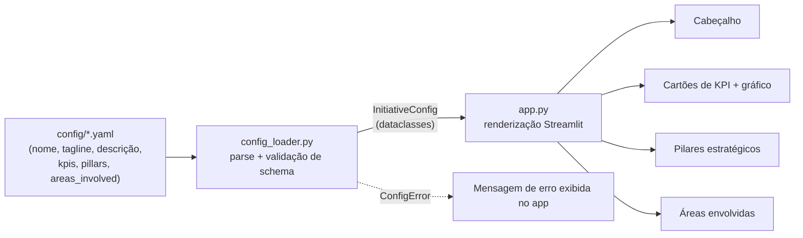

# Project KPI Dashboard

## Descrição

Template de dashboard em **Streamlit**, de página única, para apresentar o
status de um projeto ou iniciativa interna: seus pilares estratégicos,
KPIs/métricas-chave e as áreas/times envolvidos. É o tipo de painel usado em
um showcase interno ou em uma atualização para um comitê gestor.

> **Este é um projeto de portfólio/template.** Todo o conteúdo de exemplo
> (nome da iniciativa, descrição, KPIs, pilares, áreas envolvidas) é
> **100% fictício**, criado apenas para demonstrar a estrutura e o
> funcionamento do dashboard. Não representa nenhum projeto, empresa ou
> prêmio real.

## Objetivo

Fornecer uma base reutilizável e "config-driven" para quem precisa montar
rapidamente um dashboard de status de iniciativa, sem precisar reescrever a
camada de UI a cada novo projeto — basta editar um arquivo YAML.

## Funcionalidades

- Carregamento do conteúdo da iniciativa (pilares, KPIs, áreas envolvidas,
  descrição) a partir de um arquivo de configuração YAML — nada de conteúdo
  hardcoded na interface.
- Cabeçalho com nome e descrição curta da iniciativa.
- Linha de cartões de KPI (nome da métrica, valor, variação/tendência
  opcional com seta ▲/▼).
- Seção de pilares estratégicos, em colunas, cada um com título e descrição.
- Seção de áreas/times envolvidos, exibidos como badges simples.
- Gráfico de barras resumindo os KPIs numéricos (via `st.bar_chart`, sem
  dependências extras de visualização).
- Validação de schema da configuração, com mensagens de erro claras em caso
  de chave obrigatória ausente ou YAML malformado.
- Troca do arquivo de configuração diretamente pela sidebar do app.

## Tecnologias

- Python 3.11+
- [Streamlit](https://streamlit.io/)
- [PyYAML](https://pyyaml.org/)
- pytest (testes)

## Arquitetura / Fluxo



A separação entre `config_loader.py` (carregamento/validação) e `app.py`
(renderização) permite testar a lógica de dados sem depender do Streamlit.

## Estrutura

```
project-kpi-dashboard/
├── README.md
├── LICENSE
├── .gitignore
├── requirements.txt
├── pyproject.toml
├── config/
│   └── initiative_example.yaml
├── src/
│   └── project_kpi_dashboard/
│       ├── __init__.py
│       ├── config_loader.py
│       └── app.py
└── tests/
    └── test_config_loader.py
```

## Instalação

```bash
# 1. Clone o repositório e entre na pasta do projeto
cd project-kpi-dashboard

# 2. (Recomendado) Crie um ambiente virtual
python -m venv .venv
.venv\Scripts\activate      # Windows
# source .venv/bin/activate  # Linux/Mac

# 3. Instale as dependências
pip install -r requirements.txt
```

## Como executar

```bash
streamlit run src/project_kpi_dashboard/app.py
```

O app abre no navegador (geralmente em `http://localhost:8501`) já carregado
com o exemplo fictício em `config/initiative_example.yaml`. Para usar seu
próprio conteúdo, edite esse arquivo (ou informe o caminho de outro YAML na
sidebar do app).

### Rodando os testes

```bash
pytest
```

## Exemplo de entrada / saída

**Entrada** (`config/initiative_example.yaml`, resumido):

```yaml
name: "Iniciativa Alfa"
tagline: "Modelo de dashboard para acompanhamento de status, KPIs e pilares de uma iniciativa interna fictícia."
kpis:
  - name: "Satisfação dos usuários"
    value: "87%"
    delta: "+5 p.p."
    trend: "up"
pillars:
  - title: "Eficiência Operacional"
    description: "Reduzir retrabalho e tempo de ciclo por meio de automações e padronização de processos."
areas_involved:
  - "Time de Produto"
  - "Engenharia de Dados"
```

**Saída**: uma página Streamlit com o título "Iniciativa Alfa", cartões de
KPI (ex.: "Satisfação dos usuários — 87% (+5 p.p.)"), um gráfico de barras
com os valores numéricos dos KPIs, colunas com os pilares estratégicos e uma
lista de badges com as áreas envolvidas.

## Regras implementadas

- Todas as chaves de nível raiz (`name`, `tagline`, `description`, `kpis`,
  `pillars`, `areas_involved`) são obrigatórias no arquivo de configuração.
- Cada item de `kpis` precisa ter `name` e `value`; `delta` e `trend` são
  opcionais.
- Cada item de `pillars` precisa ter `title` e `description`.
- Listas vazias (`kpis: []`, `pillars: []`, `areas_involved: []`) são válidas
  e tratadas de forma graciosa na interface (mensagem informativa em vez de
  erro).
- Arquivo inexistente, YAML malformado ou chave obrigatória ausente geram
  `ConfigError` com mensagem clara indicando o problema.

## Testes

Os testes cobrem `config_loader.py` (`tests/test_config_loader.py`):

- Carregamento correto de uma configuração válida.
- Erro claro quando falta uma chave obrigatória.
- Tratamento gracioso de lista de pilares vazia.
- Erro claro quando o YAML está malformado.
- Erro claro quando o arquivo de configuração não existe.

## Segurança e privacidade

Todo o conteúdo de exemplo neste repositório (nome da iniciativa, descrição,
valores de KPI, pilares e áreas envolvidas) é **fictício** e foi criado
exclusivamente para fins de demonstração deste template. Nenhum dado real de
projeto, empresa, prêmio ou pessoa é utilizado. O app não realiza chamadas de
rede nem processa dados sensíveis — ele apenas lê um arquivo YAML local.

## Possíveis melhorias

- Suporte a múltiplos idiomas na interface.
- Cache de leitura da configuração (`st.cache_data`) para arquivos grandes.
- Exportação do dashboard como PDF/imagem.
- Suporte a fontes de dados adicionais (ex.: planilhas, APIs).
- Gráfico de radar como alternativa ao gráfico de barras para visão dos KPIs.

## Aprendizados demonstrados

- Separação de responsabilidades entre lógica de dados (`config_loader.py`)
  e camada de apresentação (`app.py`) para facilitar testes.
- Validação de schema de configuração com mensagens de erro úteis.
- Uso de `dataclasses` tipadas para modelar dados carregados de YAML.
- Construção de um app Streamlit orientado a configuração (config-driven),
  reutilizável para diferentes contextos.
- Escrita de testes unitários com `pytest`, incluindo casos de erro e de
  borda (lista vazia, YAML malformado, chave ausente).

## Licença

Distribuído sob a licença MIT. Veja o arquivo [LICENSE](LICENSE) para mais
detalhes.
